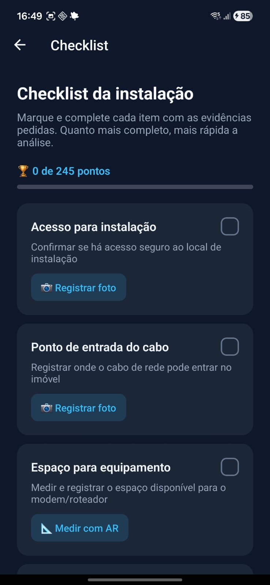

# ARLink — vistoria técnica de instalação de internet com realidade aumentada

**🏆 1º lugar — Melhor Resumo, categoria TIC · 4º Science & Business Connection (Parque de Inovação Tecnológica de São José dos Campos)**

Sistema em que o próprio cliente (ou um técnico sem experiência) coleta, pelo celular, as evidências necessárias para uma instalação de internet — medição do trajeto do cabo em realidade aumentada, posição do roteador, tomada, fotos e vídeo —, e a operadora analisa tudo remotamente, com recomendação automática de materiais e equipamentos.

Projeto Integrador da Faculdade SENAI Taubaté, desenvolvido em equipe para a provedora CTI.

<!-- TODO: adicione 2 ou 3 prints ou um GIF em docs/img/ e descomente:
| Medição em RA |
|---|---|---|
|  |
-->

---

## O problema

Antes de instalar um link, a operadora envia um técnico ao endereço só para avaliar se a instalação é viável e quanto material ela exige — o chamado *truck roll*, um dos maiores custos operacionais do setor. Para provedores pequenos, esse deslocamento pesa diretamente no preço final para o cliente.

## A solução

```
┌────────────────────┐   fotos, vídeo, medição    ┌──────────────────────┐        ┌──────────────┐
│ App do cliente     │ ─────────────────────────▶ │ API Node.js/Express  │ ◀────▶ │ AWS RDS      │
│ (Expo + ViroReact) │                            │ upload · laudos ·    │        │ MySQL        │
│ RA com ARCore      │ ── payload do laudo ──┐    │ protocolos           │        └──────────────┘
└────────────────────┘                       │    └──────────▲───────────┘
                                             ▼               │ consulta e aprova
                                   ┌──────────────────┐   ┌──┴───────────────────┐
                                   │ n8n (webhook)    │   │ Painel do NOC (Expo) │
                                   │ recomendação de  │──▶│ revisa evidências,   │
                                   │ cabo e roteador  │   │ escolhe roteador,    │
                                   └──────────────────┘   │ aprova e ativa       │
                                                          └──────────────────────┘
```

### Fluxo de um laudo

1. **NOC gera um protocolo** de 6 caracteres para o cliente → status `ABERTO`.
2. **Cliente abre o app**, informa o protocolo e segue o checklist:
   - **Medição em RA multiponto:** toca na entrada do sinal, nas curvas e no destino; o app soma os segmentos (distância euclidiana 3D entre âncoras) e acrescenta **12% de folga** para crimpagem e curvas.
   - **Tipo de passagem do cabo:** conduíte (livre/obstruído), aparente (canaleta, condulete, clips), sobre o forro ou "não sei dizer".
   - **Roteador 3D em RA:** o cliente posiciona um roteador virtual no local final e informa se há tomada a menos de 1 m e a voltagem.
   - **Fotos e vídeo do trajeto** (foto geral, quadro principal, tomada).
3. **Envio:** fotos e vídeo sobem para a API; o laudo vai para o **n8n**, que devolve um JSON com tipo e metragem de cabo, materiais e categoria de roteador → status `EM_ANALISE`.
4. **NOC revisa** as evidências no painel, escolhe o roteador entre os recomendados e **aprova** ou pede **reenvio**.
5. Após a instalação física, o NOC **ativa** o protocolo → `FINALIZADO`.

Se o n8n falhar no envio, a API **reprocessa a recomendação** quando o laudo é aberto no painel, sem o cliente precisar reenviar.

## Estrutura do repositório

```
AvaliacaoARExpo/     app do cliente/técnico — React Native (Expo 51), ViroReact (ARCore), expo-camera
  src/screens/       Welcome, CustomerData, Checklist, AR, Camera, Summary, Chat
  src/services/      cliente do chat n8n e armazenamento local (AsyncStorage)
AvaliacaoBackend/    API REST — Node.js, Express 5, Multer, mysql2
docs/                documentação técnica detalhada (arquitetura, motor de RA, recomendação, execução)
```

<!-- TODO: o painel do NOC (AvaliacaoAdminExpo) não está neste repositório. Suba a pasta e adicione aqui:
AvaliacaoAdminExpo/  painel do NOC — React Native (Expo 51)
-->

### Principais rotas da API

| Método | Rota | Função |
|---|---|---|
| `POST` | `/api/protocolos` | Cria protocolo para um cliente |
| `GET` | `/api/protocolos/:codigo` | Valida o protocolo no app |
| `POST` | `/api/upload` | Recebe foto/vídeo e devolve a URL |
| `POST` | `/api/avaliacoes` | Salva o laudo completo |
| `GET` | `/api/avaliacoes/:id/recomendacoes` | Recomendação (com reprocessamento no n8n se necessário) |
| `POST` | `/api/avaliacoes/:id/aprovar` · `/reenviar` | Decisão do NOC |
| `POST` | `/api/protocolos/:codigo/finalizar` | Ativação após a instalação |

## Como rodar

**Pré-requisitos:** Node.js 20+, um MySQL (local ou RDS), celular Android com suporte a ARCore e [ngrok](https://ngrok.com) para expor a API ao celular.

```bash
# 1. API
cd AvaliacaoBackend
cp .env.example .env          # preencha as credenciais do banco e a URL do webhook
npm install
node --env-file=.env server.js
ngrok http 3000               # copie a URL gerada

# 2. App do cliente
cd ../AvaliacaoARExpo
npm install
npx expo run:android          # RA exige build nativo; não funciona no Expo Go
```

Atualize `API_URL` nas telas do app com a URL do ngrok (ver *Limitações*). O passo a passo completo, com o roteiro de teste de ponta a ponta, está em [`docs/execucao_e_deployment.md`](docs/execucao_e_deployment.md).

## Limitações conhecidas e próximos passos

Protótipo de evento, construído em poucas semanas. O que eu mudaria para produção:

- [ ] **Autenticação do painel:** o login devolve um token fixo e as senhas usam SHA-256 sem *salt* — trocar por JWT com expiração e bcrypt.
- [ ] **Configuração:** a URL da API está repetida em três telas do app — centralizar em `app.json > extra`, como já é feito com o webhook do chat.
- [ ] **Webhooks do n8n** expostos sem autenticação — exigir o *Bearer token* que o cliente do chat já suporta.
- [ ] **Uploads em disco local** — mover para S3.
- [ ] **Testes automatizados** do cálculo de medição e das rotas da API.

## Equipe

<!-- TODO: confirme nomes e papéis -->
- **Hugo Otávio dos Santos de Paula** — <!-- TODO: seu papel, ex.: backend (API e banco), integração com o n8n e redação do resumo premiado -->
- **Misael Bonifacio Morgado** — <!-- TODO -->
- **Pedro Santos** — <!-- TODO -->

Faculdade SENAI Taubaté · Análise e Desenvolvimento de Sistemas · 2026

## Tecnologias

React Native · Expo · TypeScript/JavaScript · ViroReact (ARCore) · Node.js · Express · MySQL · AWS RDS · n8n · ngrok
