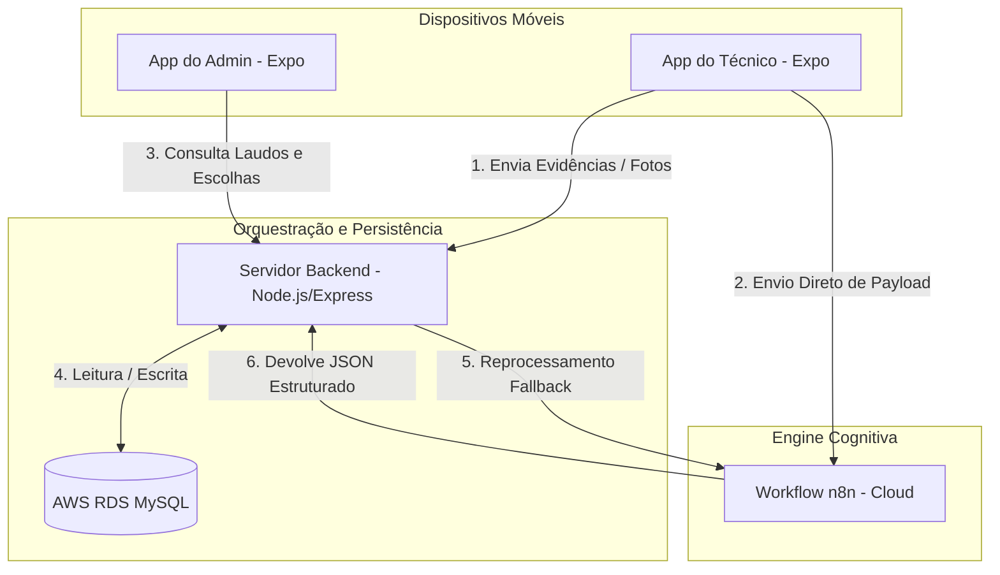
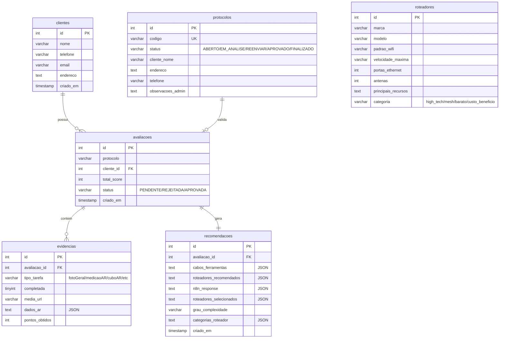

# Arquitetura Geral e Ciclo de Vida do Laudo

Esta unidade descreve os pilares arquiteturais do sistema, o esquema de dados do banco de dados AWS RDS MySQL e o ciclo de vida operacional de um laudo técnico, desde a criação do protocolo até a ativação pelo NOC.

---

## 🏗️ Diagrama de Arquitetura

O sistema opera com um backend centralizador integrado a duas aplicações móveis (cliente técnico e painel administrativo), persistência em banco de dados relacional e inteligência externa via webhook n8n:

---

## 🛠️ Stack Tecnológico

O ecossistema é construído usando tecnologias consolidadas de mercado:

| Componente | Tecnologia / Dependência Principal | Finalidade |
| :--- | :--- | :--- |
| **Aplicativo do Técnico** | React Native (Expo v51), `@reactvision/react-viro` | Execução em campo, Realidade Aumentada e Câmera. |
| **Painel Admin / NOC** | React Native (Expo v51) | Gerenciamento administrativo, aprovação física e ativação. |
| **Servidor Backend** | Node.js, Express (v5), Multer | API REST, upload de arquivos e conexões SQL. |
| **Banco de Dados** | AWS RDS (MySQL 3306), `mysql2/promise` | Persistência transacional dos dados da vistoria e roteadores. |
| **Automação** | Webhook n8n Cloud | Processamento inteligente de imagens e geração de relatórios. |

---

## 🗄️ Esquema do Banco de Dados (Schema RDS)

O banco de dados armazena as informações estruturadas de clientes, avaliações, evidências espaciais, catálogo de roteadores e recomendações:

---

## 🔄 Ciclo de Vida do Laudo Técnico

A jornada do laudo técnico segue as 6 fases abaixo para assegurar conformidade operacional total:

### Fase 1: Emissão do Protocolo (NOC)
O administrador cria um novo cliente no painel Admin (aba **Novo**), gerando um código alfa-numérico único de 6 dígitos (ex: `8F3A2B`) que muda o status do protocolo para `ABERTO`.

### Fase 2: Coleta de Campo e Realidade Aumentada (Técnico)
O técnico digita o código no aplicativo móvel. O app valida o protocolo com o backend e libera o checklist de **6 tarefas (totalizando 100 pontos)**:
1. **Foto Geral do Local** (15 pontos): Captura o ponto geral de onde a instalação será efetuada.
2. **Medição AR** (25 pontos): Define a entrada do link físico e o caminho do cabo UTP usando medição espacial.
3. **Simulação Cubo 3D** (15 pontos): Posiciona virtualmente o roteador, coletando dados de tomadas e voltagens elétricas.
4. **Vídeo da Rota** (25 pontos): Filma o trajeto real traçado pelo cabo para auditoria.
5. **Foto do Quadro Telecom/Energia** (10 pontos): Coleta o estado físico da caixa distribuidora.
6. **Foto da Tomada Próxima** (10 pontos): Foto aproximada do ponto de energia para o roteador.

### Fase 3: Upload e Análise Inteligente (Direct Webhook)
Na tela de resumo, o técnico escolhe a complexidade preliminar, categorias de roteador desejadas e clica em **Enviar para análise**:
* O aplicativo converte a **Foto Geral** para base64 e dispara uma requisição POST direta ao webhook do n8n para processar a inteligência do laudo técnico.
* O aplicativo faz o upload dos arquivos físicos de fotos e vídeos para o backend (`/api/upload`) e em seguida envia o laudo completo com o retorno do n8n para salvar no backend (`/api/avaliacoes`). O status no banco avança para `EM_ANALISE`.

### Fase 4: Auditoria Física e Reenvio (Admin)
O NOC abre o painel do administrador, seleciona o laudo sob a aba **Laudos** e verifica todas as evidências coletadas: a rota do cabo, os dados das tomadas, as fotos do quadro e da tomada.
* Se faltar alguma imagem correta ou a rota de cabo estiver incorreta: o NOC digita uma observação e clica em **Rejeitar e Pedir Reenvio**. O laudo vai para `REJEITADA` e o protocolo volta para `REENVIAR`. O aplicativo do técnico detecta a mensagem de erro ao verificar o código e permite que o técnico tire novas fotos ou meça novamente.

### Fase 5: Escolha do Roteador e Aprovação Física (Admin)
Se tudo estiver correto, o painel do administrador exibe os materiais recomendados diretamente pelo n8n e destaca com estrelas/badges os roteadores compatíveis indicados pelo motor de IA.
* O administrador seleciona o roteador final disponibilizado em estoque que será enviado com o técnico e clica em **Salvar Escolha de Roteador**.
* O administrador clica em **Aprovar Instalação (Física)**, mudando o status da avaliação para `APROVADA` e do protocolo para `APROVADO`.

### Fase 6: Ativação Física e Finalização (NOC)
Assim que os técnicos no local concluem a passagem dos cabos físicos e conectam o roteador, o NOC abre a aba **Protocolos/NOC** no painel admin, confere o status e clica em **Ativar NOC**. O backend altera o status do protocolo para `FINALIZADO` no RDS, liberando a instalação na operadora e dispensando o técnico de campo.
