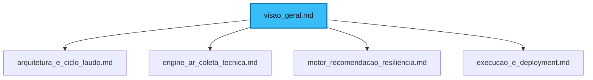

# Visão Geral do Sistema: Taubaté Conectada (Raízes de Taubaté)

Este é o documento mestre de documentação do projeto **Taubaté Conectada** (com a iniciativa **Raízes de Taubaté**), desenvolvido como um projeto de **Extensão Universitária** sob a égide da **UNISENAI**. O sistema une tecnologia de ponta (**Realidade Aumentada**), automação inteligente (**n8n**) e impacto social para revitalizar a conexão comunitária, otimizar infraestruturas e valorizar o patrimônio histórico regional.

---

## 🎓 Identificação do Projeto

| Atributo | Detalhes |
| :--- | :--- |
| **Instituição** | Faculdade de Tecnologia SENAI Félix Guisard (Taubaté, SP) |
| **Programa** | Extensão Universitária — UNISENAI |
| **Nome do Projeto** | Taubaté Conectada / Raízes de Taubaté |
| **Integrantes (Alunos)** | Julio Morais, Misael Morgado, Pedro Gabriel, Hugo Otávio |
| **Orientador** | Prof. Anderson Matos |
| **Horas de Desenvolvimento** | 80 horas de pesquisa, desenvolvimento e integração |

---

## 🎯 Objetivos do Projeto

O projeto **Taubaté Conectada** foi concebido com uma missão dupla:

### 1. Sala de Aula a Céu Aberto & Cidadania
Transformar o território urbano de Taubaté em um polo cultural interativo, traduzindo o patrimônio histórico (como o Sítio do Picapau Amarelo, o Cristo Redentor, igrejas centenárias e museus locais) para a linguagem digital do século XXI. A iniciativa visa resgatar as narrativas do ciclo do café, Monteiro Lobato e Amácio Mazzaropi para as novas gerações.

### 2. Catalisador de Impacto Social & Conexão
Conectar diretamente o turismo cultural e a inclusão digital a frentes comunitárias locais de solidariedade. A plataforma permite integrar rotas físicas de exploração urbana com ações de voluntariado e apoio à terceira idade, proteção infantil, causa animal e segurança alimentar (auxiliando abrigos, lares de acolhimento e famílias vulneráveis).

### 3. Eliminação do Custo Operacional (Truck Roll) em Telecomunicações
Para viabilizar a infraestrutura de rede que conecta esses pontos turísticos, sedes de ONGs e centros comunitários, desenvolvemos um **Sistema de Avaliação Técnica em Realidade Aumentada (RA)**. Esse sistema elimina a necessidade de deslocamentos técnicos de vistoria física (*truck rolls*), empoderando a ponta a mapear as instalações de conectividade de forma remota, precisa e gamificada.

---

## 🗺️ Mapa da Documentação

A documentação está estruturada de maneira modular para cobrir desde a arquitetura de rede até o deploy prático do protótipo:

### [Unidade 1: Arquitetura Geral e Ciclo de Vida do Laudo]
Apresenta o ecossistema tecnológico (React Native, Node.js, AWS RDS MySQL) e o ciclo de transição de status dos laudos entre o NOC e o técnico de campo.

### [Unidade 2: Engine de Realidade Aumentada (AR) e Coleta Técnica]
Esmiúça a integração com `@reactvision/react-viro`, a matemática de medição multi-ponto com 12% de margem, simulação do roteador 3D, verificação de voltagem e modal de infraestrutura de passagem de cabo.

### [Unidade 3: Mecanismo de Recomendação Dinâmica e Resiliência]
Explica a integração com o webhook cognitivo do **n8n**, a extração estritamente dinâmica de materiais (sem dados chumbados na API) e o auto-healing para reprocessamento automático em background.

### [Unidade 4: Guia de Execução, Instalação e Testes]
O guia passo a passo de como rodar localmente o servidor backend, configurar o ngrok e inicializar os aplicativos do técnico e do administrador via Expo Metro Bundler.

---

## 📦 Componentes do Protótipo Integrado

Para cumprir a metodologia traçada (Mapeamento Cultural, Guia Automático Inteligente, Integração Tecnológica e Conexão Social), a plataforma é composta por:

* **Aplicativo do Técnico / Cliente (AvaliacaoARExpo):** Canal móvel de mapeamento em campo. Permite tirar as fotos georreferenciadas dos pontos históricos ou comunitários e traçar a rota exata de cabo de rede com fidelidade espacial.
* **Guia Inteligente / Chatbot (n8n):** Orquestrador cognitivo integrado. Além de fornecer recomendações de materiais técnicos para as instalações, auxilia o cidadão/turista montando roteiros de viagem e visitas solidárias personalizados de acordo com seu perfil.
* **Painel Administrativo NOC (AvaliacaoAdminExpo):** Painel do Centro de Operações. Garante a conformidade dos dados, revisa evidências contra fraudes de localização e aprova fisicamente os roteiros de rede.
* **Servidor e Banco de Dados Cloud (Backend & AWS RDS):** Repositório unificado das vistorias, rotas e catálogos de equipamentos para garantir escalabilidade operacional.
